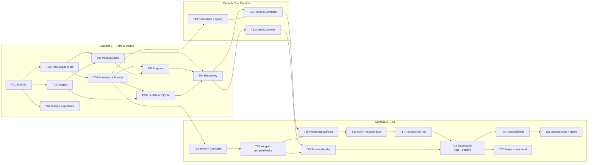
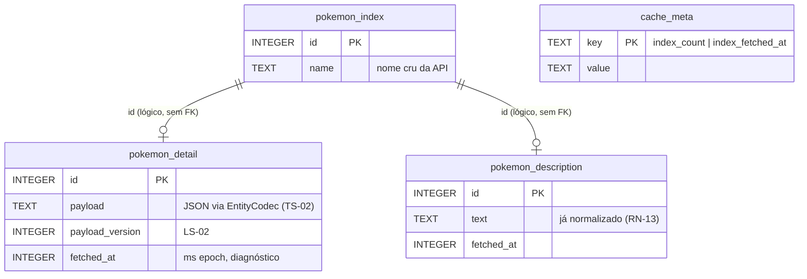

# feat: implementar Pokédex Gen 1 (MVC + Provider + cache em 2 níveis) — Extensive

## Overview

Backlog sequencial para construir, do zero, o app Flutter descrito no [PRD](../brainstorm/2026-10-30-pokedex-prd-brainstorm-doc.md) e na [Tech Spec](../tech-spec/2026-10-30-pokedex-tech-spec.md). São **22 tasks** em **3 camadas lógicas**, executadas em **9 fases** — uma fase = um commit/PR revisável; cada fase cabe numa janela de contexto do `/build` e termina com o app compilando, testes verdes e cobertura ≥ 80% (a partir da Fase 2):

| Camada | Fases | Tasks | Entrega |
|---|---|---|---|
| **1 — Infraestrutura & Dados** | 1 Fundação · 2 Dados remotos · 3 Cache e repository | T01–T09 | Projeto, core, logging, guarda de arquitetura, contrato de dados, API, SQLite, repository |
| **2 — Domínio** | 4 Domínio | T10–T12 | Regras de busca/ordenação e controllers (máquinas de estado) |
| **3 — UI** | 5 UI base · 6 Lista · 7 Detalhe · 8 Acabamento · 9 Swipe (opcional) | T13–T22 | Tema, widgets, telas, navegação, acessibilidade, splash |

IDs `RF-`, `RN-`, `E-`, `ERR-`, `RNF-`, `UC-` vêm do PRD; `TS-`, `LS-` e `§n` vêm da Tech Spec.

## Problem Statement

O repositório contém apenas documentação (PRD + Tech Spec); nenhum projeto Flutter existe. A Tech Spec define contratos, máquinas de estado e regras de cache, mas não define **ordem de construção**, **fatias entregáveis** nem **critérios de aceite verificáveis** por task. Sem isso, o risco é construir UI sobre contratos instáveis, descobrir violações de camada tarde e chegar ao fim com cobertura < 80% ou estados não desenhados (E-01, E-03, E-05, E-06, E-08, E-09) esquecidos.

## Proposed Solution

Construção **de dentro para fora**, seguindo as setas de dependência da §2.1 da Tech Spec:

1. **Infraestrutura & Dados** — tudo o que não depende de Flutter UI: scaffold, `Result`/`AppFailure`, logging, entidades (o contrato de dados que a camada `data/` emite), `PokeApiClient`, mappers, `SqflitePokemonLocalStore`, `CachedPokemonRepository`.
2. **Domínio** — o comportamento: `TextNormalizer`, `PokedexQuery`, `PokedexController`, `PokemonDetailController`, testados com `FakePokemonRepository` (`Completer`) sem nenhum widget.
3. **UI** — tema e contraste, widgets compartilhados, telas, composition root, navegação, acessibilidade.

> **Nota sobre a ordem pedida (dados → domínio → UI).** Neste MVC, os mappers de `models/data/` **produzem** entidades e usam `PokemonFormat` (RN-13). Por isso as **entidades e a formatação** entram na Camada 1 como *contrato de dados* (T05), e a Camada 2 concentra o **comportamento** (busca, ordenação, estados). Nenhuma task depende de outra posterior.

Cada task segue TDD: o teste nasce junto com o código, no mesmo commit (`<type>(<scope>): <descrição>`).

## Technical Approach

### Architecture

Camadas, regras de import e estrutura de pastas: Tech Spec §2.1–§2.3 (fonte de verdade; não duplicada aqui). A guarda automatizada dessas regras é criada cedo (T04), então cada task seguinte é validada contra ela.

#### Grafo de dependências das tasks



#### ERD — cache L2 (SQLite, `user_version = 1`)



Sem foreign keys reais: as tabelas são caches independentes (TS-05) e podem ser preenchidas em qualquer ordem.

### Definition of Done (vale para toda task)

- [ ] Testes da task escritos e verdes; nenhum teste anterior quebrado (`flutter test`).
- [ ] `flutter analyze --fatal-infos` sem issues; `dart format --output=none --set-exit-if-changed lib test` limpo.
- [ ] Nomes de teste rastreáveis: `group('<Classe>') > group('<método>') > test('RN-17 descarta resposta obsoleta')` — o ID do PRD/Spec abre o nome do teste.
- [ ] Guarda de arquitetura (T04) verde.
- [ ] Todo caminho de falha novo tem log afirmado em teste (nível + logger + mensagem — PRD §11.5).
- [ ] Nenhum `catch` vazio (ERR-08); nenhum `print`.
- [ ] Um commit por task, mensagem `<type>(<scope>): <descrição>`.

### Convenções de teste (aprendizados de iterações anteriores)

| Armadilha | Padrão correto |
|---|---|
| `MediaQueryData(textScaler: ...)` criado do zero zera `size` e gera overflows falsos | `Builder` + `MediaQuery.of(context).copyWith(textScaler: ...)` |
| Definir `SynchronousFuture` localmente / importar `dart:ui` em fake de imagem | `SynchronousFuture` vem de `package:flutter/foundation.dart` |
| Teste de arquitetura com *substring match* acusa comentários que citam símbolos proibidos | Remover comentários (`//`, `/* */`) antes do scan; registrar quantos arquivos foram lidos; validar com uma quebra proposital **por import real** |
| Guarda `_disposed` testada só pelo listener não detecta mutação de estado pós-dispose | Teste deve gravar `state` antes do `dispose`, completar o `Completer` e afirmar que `state` **não** mudou |
| Template Android com Kotlin < 2.2.20 falha no Flutter 3.47 (`DependencyVersionChecker`) | Garantir KGP ≥ 2.2.20 em `android/settings.gradle.kts` |
| `pumpAndSettle` nunca termina com indicador de progresso indeterminado (E-01, E-06, `isRetryingDescription`) | Usar `pump()` enquanto carrega; `pumpAndSettle` só após completar o `Completer`; `AnimatedContainer` avançado com `pump(const Duration(milliseconds: 300))`; sqflite real dentro de `testWidgets` só via `tester.runAsync` |
| `very_good test` roda todos os arquivos num único isolate → estado global vaza (`Logger.root`, listeners, `hierarchicalLoggingEnabled`, `databaseFactory` global) | `LogRecorder` e testes de logging restauram nível e chamam `Logger.root.clearListeners()` no `tearDown`; `DatabaseFactory` sempre injetada pelo construtor, nunca atribuída ao global |
| `Image.network` em teste de página recebe HTTP 400 do stub do `flutter_test` → erros assíncronos | Ponto de injeção `ArtworkImageResolver` (T14) sobrescrito pelo `pumpApp` |
| Setup de widget test duplicado em 6 tasks | `test/helpers/pump_app.dart` (T14): tema, providers, resolver fake, viewport 360×640 via `tester.view` + `addTearDown(tester.view.reset)` |
| `test/` espelha `lib/` (Tech Spec §2.3) | Exceção documentada: `test/flows/` e `test/accessibility/` são testes transversais sem arquivo-par em `lib/` |

---

## Implementation Phases

### Phase 1: Fundação (Camada 1)

- **Status:** Not started
- **Scope:** Projeto Flutter compilável, tipos de erro/resultado, logging configurável, guarda de arquitetura e o contrato de dados (entidades + formatação).
- **Files touched:** `pubspec.yaml`, `analysis_options.yaml`, `android/settings.gradle.kts`, `lib/main.dart` (provisório), `lib/core/errors/*`, `lib/core/logging/*`, `lib/models/entities/*`, `lib/models/rules/pokemon_format.dart`, `test/architecture/*`, `test/helpers/log_recorder.dart`, `test/core/**`, `test/models/entities/**`, `test/models/rules/pokemon_format_test.dart`
- **Acceptance criteria:** T01–T05 concluídas.
- **Validation:** `flutter analyze --fatal-infos && flutter test && flutter build apk --debug`

### Phase 2: Dados remotos (Camada 1)

- **Status:** Not started
- **Scope:** Acesso à PokéAPI com mapeamento de falhas, fixtures reais e mappers JSON → entidades.
- **Files touched:** `lib/models/data/remote/**`, `test/fixtures/*.json`, `test/models/data/remote/**`
- **Acceptance criteria:** T06–T07 concluídas.
- **Validation:** `flutter analyze --fatal-infos && very_good test --coverage --min-coverage 80 --exclude-coverage "lib/main.dart"`

### Phase 3: Cache e repository (Camada 1)

- **Status:** Not started
- **Scope:** Cache L2 em SQLite (best-effort) e `CachedPokemonRepository` com L1, dedupe e composição núcleo × descrição.
- **Files touched:** `lib/models/data/local/**`, `lib/models/data/pokemon_repository.dart`, `lib/models/data/cached_pokemon_repository.dart`, `test/models/data/local/**`, `test/models/data/cached_pokemon_repository_test.dart`, `test/helpers/fake_pokemon_local_store.dart`, `test/helpers/fake_pokemon_repository.dart`
- **Acceptance criteria:** T08–T09 concluídas.
- **Validation:** `flutter analyze --fatal-infos && very_good test --coverage --min-coverage 80 --exclude-coverage "lib/main.dart"`

### Phase 4: Domínio (Camada 2)

- **Status:** Not started
- **Scope:** Regras puras de busca/ordenação e os dois controllers com suas máquinas de estado.
- **Files touched:** `lib/models/rules/text_normalizer.dart`, `lib/models/rules/pokedex_query.dart`, `lib/controllers/**`, `test/models/rules/**`, `test/controllers/**`
- **Acceptance criteria:** T10–T12 concluídas.
- **Validation:** `flutter analyze --fatal-infos && very_good test --coverage --min-coverage 80 --exclude-coverage "lib/main.dart"`

### Phase 5: UI base (Camada 3)

- **Status:** Not started
- **Scope:** Tokens de tema, regra de contraste, fontes/assets, widgets compartilhados e helpers de widget test. Depende só da Fase 1 (T05) — pode rodar em paralelo às Fases 2–4.
- **Files touched:** `assets/**`, `pubspec.yaml`, `lib/core/theme/**`, `lib/views/shared/**`, `test/core/theme/**`, `test/views/shared/**`, `test/helpers/fake_image_provider.dart`, `test/helpers/pump_app.dart`
- **Acceptance criteria:** T13–T14 concluídas.
- **Validation:** `flutter analyze --fatal-infos && very_good test --coverage --min-coverage 80 --exclude-coverage "lib/main.dart"`

### Phase 6: Tela de lista (Camada 3)

- **Status:** Not started
- **Scope:** `PokedexPage` completa (E-01..E-05) e composition root: o app roda e lista os 151.
- **Files touched:** `lib/views/pokedex/**`, `lib/app.dart`, `lib/main.dart`, `lib/core/logging/app_logging.dart`, `test/views/pokedex/**`, `test/app_test.dart`
- **Acceptance criteria:** T15–T17 concluídas.
- **Validation:** `flutter analyze --fatal-infos && very_good test --coverage --min-coverage 80 --exclude-coverage "lib/main.dart" && flutter build apk --debug`

### Phase 7: Detalhe, navegação e acessibilidade (Camada 3)

- **Status:** Not started
- **Scope:** `PokemonDetailPage` (E-06..E-10), fluxo lista↔detalhe com preservação de estado e auditoria de acessibilidade.
- **Files touched:** `lib/views/detail/**`, `lib/views/pokedex/pokedex_page.dart`, `lib/app.dart`, `test/views/detail/**`, `test/flows/**`, `test/accessibility/**`
- **Acceptance criteria:** T18–T20 concluídas.
- **Validation:** `flutter analyze --fatal-infos && very_good test --coverage --min-coverage 80 --exclude-coverage "lib/main.dart"`

### Phase 8: Acabamento (Camada 3)

- **Status:** Not started
- **Scope:** Splash/ícone nativos, gates finais de qualidade e roteiro manual em Android/iOS.
- **Files touched:** `android/app/src/main/res/**`, `ios/Runner/Assets.xcassets/**`, `ios/Runner/Base.lproj/LaunchScreen.storyboard`
- **Acceptance criteria:** T21 concluída.
- **Validation:** `flutter analyze --fatal-infos && very_good test --coverage --min-coverage 80 --exclude-coverage "lib/main.dart" && flutter build apk --debug`

### Phase 9: Swipe na arte — opcional (Camada 3)

- **Status:** Not started
- **Scope:** Gesto de swipe equivalente às setas ‹ › (RF-24, nice-to-have). Pode ser cortado sem afetar as demais fases.
- **Files touched:** `lib/views/detail/widgets/artwork_pager.dart`, `test/views/detail/artwork_pager_test.dart`
- **Acceptance criteria:** T22 concluída.
- **Validation:** `flutter analyze --fatal-infos && very_good test --coverage --min-coverage 80 --exclude-coverage "lib/main.dart"`

---

## Backlog de Tasks

Legenda de tamanho: **P** ≤ 2h · **M** ½ dia · **G** 1 dia.

| # | Task | Camada | Tam. | Depende de |
|---|---|---|---|---|
| T01 | Scaffold do projeto e dependências | 1 | P | — |
| T02 | `Result<T>` e taxonomia `AppFailure` | 1 | P | T01 |
| T03 | Logging hierárquico | 1 | P | T01 |
| T04 | Guarda de arquitetura e dependências | 1 | M | T01 |
| T05 | Entidades e `PokemonFormat` (contrato de dados) | 1 | M | T02 |
| T06 | `PokeApiClient` + fixtures reais | 1 | M | T02, T03 |
| T07 | `PokemonMappers` | 1 | M | T05, T06 |
| T08 | Cache L2: `EntityCodec` + `SqflitePokemonLocalStore` | 1 | G | T03, T05 |
| T09 | `CachedPokemonRepository` (L1 + L2 + rede) | 1 | G | T06, T07, T08 |
| T10 | `TextNormalizer` + `PokedexQuery` | 2 | M | T05 |
| T11 | `PokedexController` | 2 | M | T09, T10 |
| T12 | `PokemonDetailController` | 2 | G | T09 |
| T13 | Tema, tokens e `Contrast` | 3 | M | T05 |
| T14 | Widgets compartilhados | 3 | M | T13 |
| T15 | Header: busca e ordenação | 3 | M | T11, T14 |
| T16 | Grid e estados da lista | 3 | M | T15 |
| T17 | Composition root (`main.dart`, `app.dart`) | 3 | P | T16 |
| T18 | Tela de detalhe | 3 | G | T12, T14 |
| T19 | Navegação lista ↔ detalhe | 3 | M | T17, T18 |
| T20 | Acessibilidade | 3 | M | T19 |
| T21 | Splash, ícone e gates finais | 3 | P | T20 |
| T22 | Swipe na arte (RF-24, opcional) | 3 | P | T19 |

---

### Camada 1 — Infraestrutura & Dados

#### T01 — Scaffold do projeto e dependências

**Objetivo:** projeto Flutter mínimo, compilável em Android/iOS, com exatamente as dependências da Tech Spec §11.
**Refs:** RNF-01, RNF-06, RNF-07, TS-14, Tech Spec §11.
**Arquivos:** `pubspec.yaml`, `pubspec.lock`, `analysis_options.yaml`, `android/settings.gradle.kts`, `lib/main.dart` (provisório, compila sozinho até T17), `.gitignore`, `.github/workflows/main.yaml`.

Passos-chave: `flutter create --org dev.paulosabra --project-name pokedex --platforms android,ios .`; remover app contador, `test/widget_test.dart` e `cupertino_icons`; adicionar `provider`, `http`, `logging`, `sqflite`, `path`; dev: `flutter_lints`, `sqflite_common_ffi`; confirmar KGP ≥ 2.2.20; adicionar `ruvector.db`, `.swarm/`, `.claude-flow/` ao `.gitignore`.

**Critérios de aceite**
- [ ] `flutter pub get` resolve; `pubspec.lock` versionado.
- [ ] `flutter analyze --fatal-infos` sem issues (a lista de dependências é validada por teste em T04).
- [ ] CI em `.github/workflows/main.yaml` com Flutter 3.47.8 fixado, `libsqlite3-dev` instalado (ffi no Linux), rodando format, analyze e `very_good test --coverage --min-coverage 80 --exclude-coverage "lib/main.dart"` (o gate de cobertura passa a valer a partir da Fase 2).
- [ ] `flutter build apk --debug` conclui (Kotlin Gradle Plugin ≥ 2.2.20).
- [ ] Artefatos locais de ferramentas (`ruvector.db`, `.swarm/`, `.claude-flow/`) ignorados pelo git.

**Verify:** `flutter analyze --fatal-infos && flutter build apk --debug`

#### T02 — `Result<T>` e taxonomia `AppFailure`

**Objetivo:** tipos selados que garantem, pelo compilador, que Controllers nunca veem exceções técnicas (TS-06).
**Refs:** PRD §10.1, §10.3; Tech Spec §5.1.
**Arquivos:** `lib/core/errors/result.dart`, `lib/core/errors/app_failure.dart`, `test/core/errors/app_failure_test.dart`, `test/core/errors/result_test.dart`.

**Critérios de aceite**
- [ ] `Result<T>` selado com `Ok<T>(value)` e `Err<T>(failure)`; `switch` exaustivo compila sem `default`.
- [ ] 7 subtipos de `AppFailure` (Network, Timeout, NotFound, RateLimit, Server(statusCode), Parsing, Unexpected), todos `final class`.
- [ ] `userMessage` de cada subtipo é **idêntico** ao texto da tabela PRD §10.3 (teste parametrizado com as 7 strings).
- [ ] `cause`/`stackTrace` nunca aparecem em `userMessage` (teste com `cause` contendo texto sentinela).

**Verify:** `flutter test test/core/errors`

#### T03 — Logging hierárquico

**Objetivo:** configuração única do pacote `logging` e nomes de loggers centralizados.
**Refs:** D6, PRD §11.1–§11.5, Tech Spec §9.
**Arquivos:** `lib/core/logging/loggers.dart`, `lib/core/logging/app_logging.dart`, `test/helpers/log_recorder.dart`, `test/core/logging/app_logging_test.dart`.

**Critérios de aceite**
- [ ] `loggers.dart` expõe constantes para os 8 loggers da Tech Spec §9 (`pokedex.app`, `.api`, `.repository`, `.storage`, `.controller.list`, `.controller.detail`, `.view.image`) e a raiz `pokedex`.
- [ ] `configureLogging({required bool release})` liga `hierarchicalLoggingEnabled`, define `Level.ALL` (debug) ou `Level.WARNING` (release) e registra **um** listener que encaminha para `dart:developer.log` com `name`, `level`, `error`, `stackTrace`.
- [ ] Chamar `configureLogging` duas vezes não duplica o listener (idempotente).
- [ ] `LogRecorder` (helper de teste) anexa a `Logger('pokedex')`, expõe `records`, oferece `expectLog(level, logger, contains)` e no `tearDown` cancela a assinatura e restaura `Logger.root.level` (seguro no isolate único do `very_good test`); é usado por todas as tasks seguintes.

**Verify:** `flutter test test/core/logging`

#### T04 — Guarda de arquitetura e dependências

**Objetivo:** regras de import da §2.2 e lista de dependências de RNF-07 viram testes que quebram o build ao serem violadas.
**Refs:** Tech Spec §2.2, §10 (linha "Arquitetura"), §11; RNF-07.
**Arquivos:** `test/architecture/import_rules_test.dart`, `test/architecture/dependencies_test.dart`, `test/architecture/source_scanner.dart`.

**Critérios de aceite**
- [ ] `source_scanner.dart` **remove comentários** (`//` e `/* */`) antes de extrair imports; teste unitário do próprio scanner com fonte sintética: import real é detectado, import citado em comentário é ignorado (substitui a quebra proposital manual).
- [ ] Uma regra por linha da tabela §2.2 (views, controllers, `cached_pokemon_repository.dart`, `data/remote/`, `data/local/`, `core/`). Diretório existente → afirma `files.isNotEmpty` antes de checar; diretório ainda inexistente → `skip` com motivo (nunca passa vazio, nunca quebra fases iniciais).
- [ ] Regra extra: só `sqflite_pokemon_local_store.dart` e `local_schema.dart` em `models/` podem importar `package:sqflite`.
- [ ] `dependencies_test.dart` lê `pubspec.yaml` **linha a linha** (sem pacote `yaml`, evitando `depend_on_referenced_packages`) e afirma runtime = `{flutter, provider, http, logging, sqflite, path}` e dev ⊆ `{flutter_test, flutter_lints, sqflite_common_ffi}`.

**Verify:** `flutter test test/architecture`

#### T05 — Entidades e `PokemonFormat` (contrato de dados)

**Objetivo:** vocabulário imutável que a camada de dados produz e a UI consome, com as regras de exibição.
**Refs:** D5, RN-02, RN-03, RN-10, RN-11, RN-12 (formatação), RN-13 (normalização), RN-15, ERR-05; Tech Spec §5.2, §5.3 (`PokemonFormat`), TS-08.
**Arquivos:** `lib/models/entities/{pokemon_summary,pokemon_detail,pokemon_type,pokemon_stat,sort_order}.dart`, `lib/models/rules/pokemon_format.dart`, `test/models/entities/*_test.dart`, `test/models/rules/pokemon_format_test.dart`.

**Critérios de aceite**
- [ ] Entidades `final class` com campos `final`; listas e mapas expostos via `List.unmodifiable`/`Map.unmodifiable` (mutação lança `UnsupportedError` — testado).
- [ ] `PokemonType.fromApi`: 18 nomes conhecidos + qualquer outro → `unknown` (RN-10).
- [ ] `StatKind.fromApi('special-attack') == specialAttack`; nome desconhecido → `null`; labels `HP, ATK, DEF, SATK, SDEF, SPD`.
- [ ] `PokemonSummary(id: 4)`: `number == '#004'`, `artworkUrl` = URL `official-artwork/4.png` da PRD §13.4.
- [ ] `PokemonFormat.displayName`: `bulbasaur→Bulbasaur`, `nidoran-f→Nidoran♀`, `nidoran-m→Nidoran♂`, `mr-mime→Mr. Mime`, `farfetchd→Farfetch’d`.
- [ ] `weightKg(69) == '6.9 kg'`, `heightM(7) == '0.7 m'`, `weightKg(null) == '—'`, `heightM(null) == '—'`.
- [ ] `abilityName('solar-power') == 'Solar Power'`.
- [ ] `statValue(45) == '045'`; `statFraction`: `0→0.0`, `255→1.0`, `300→1.0`, `-1→0.0`.
- [ ] `flavorText` troca `\n`, `\f` e soft hyphen (`­`) por espaço e colapsa espaços.
- [ ] `PokemonDetail.withDescription` devolve cópia; `primaryType == types.first`; `summary` preserva `id`/`name`.

**Verify:** `flutter test test/models/entities test/models/rules/pokemon_format_test.dart`

#### T06 — `PokeApiClient` + fixtures reais

**Objetivo:** único ponto de I/O de rede, convertendo transporte/status em `AppFailure`.
**Refs:** PRD §10.2, §11.3–§11.4, §13.4; Tech Spec §5.4, TS-12.
**Arquivos:** `lib/models/data/remote/endpoints.dart`, `lib/models/data/remote/poke_api_client.dart`, `test/fixtures/{index_151,bulbasaur,bulbasaur_species,charmander,mr_mime}.json`, `test/models/data/remote/poke_api_client_test.dart`.

Passo inicial: capturar as fixtures da PokéAPI real com `curl` (uma vez, versionadas). Para `/pokemon/{id}`, manter o payload integral de pelo menos uma fixture (> 64 KB) para exercitar o caminho com isolate.

**Critérios de aceite**
- [ ] `fetchIndex` chama `GET {base}pokemon?limit=151&offset=0`; `fetchPokemon(4)` → `pokemon/4`; `fetchSpecies(4)` → `pokemon-species/4` (verificado no `MockClient`).
- [ ] Mapeamento (um teste por linha): 200 → `Ok(JsonMap)`; 404 → `NotFoundFailure`; 429 → `RateLimitFailure`; 500 e 418 → `ServerFailure(statusCode)`; `SocketException`/`ClientException` → `NetworkFailure`; atraso > `timeout` → `TimeoutFailure` (teste determinístico: `timeout` de 10ms injetado + `MockClient` que nunca completa; sem `fake_async`); corpo não-JSON ou JSON não-objeto → `ParsingFailure`; outra exceção → `UnexpectedFailure`.
- [ ] Níveis de log: 404/429/rede/timeout → WARNING; 5xx/parsing/unexpected → SEVERE (logger `pokedex.api`); sucesso → FINE `GET /pokemon/4 → 200 {ms=…, req=…}`.
- [ ] `req` incrementa por instância e aparece nos logs de início e fim da mesma requisição.
- [ ] Corpo > 64 KB é decodificado via `Isolate.run` (decisão por tamanho coberta por teste da função de decisão); o corpo nunca é logado inteiro.
- [ ] Nunca lança: todos os caminhos retornam `Result`.

**Verify:** `flutter test test/models/data/remote/poke_api_client_test.dart`

#### T07 — `PokemonMappers`

**Objetivo:** JSON da PokéAPI → entidades, com tolerância a opcionais e rigor em obrigatórios.
**Refs:** RN-01, RN-12, RN-13, ERR-05; Tech Spec §5.4.
**Arquivos:** `lib/models/data/remote/pokemon_mappers.dart`, `test/models/data/remote/pokemon_mappers_test.dart`.

**Critérios de aceite**
- [ ] `index(fixture index_151)` → 151 itens, ids 1..151 extraídos da URL (RN-01); entrada com URL sem id é descartada com WARNING em `pokedex.repository`.
- [ ] `detail(bulbasaur)`: tipos `[grass, poison]` em ordem de slot; `weightHg 69`, `heightDm 7`; abilities ordenadas por `slot` (oculta incluída), no máximo 2; 6 stats.
- [ ] `detail(mr_mime)` → `name == 'mr-mime'` (display name derivado em T05).
- [ ] Ausência de `abilities`, `weight`, `height` ou de um stat **não** lança (ERR-05) → lista vazia / `null` / chave ausente.
- [ ] Ausência de `id`, `name` ou `types` (ou `types` vazio) **lança** (`FormatException`/`TypeError`) — o repository converte (T09).
- [ ] Stats desconhecidos são ignorados; tipo desconhecido → `PokemonType.unknown`.
- [ ] `description(bulbasaur_species)` retorna a 1ª entrada `en`, já passada por `PokemonFormat.flavorText`; sem entrada `en` → `null`.

**Verify:** `flutter test test/models/data/remote/pokemon_mappers_test.dart`

#### T08 — Cache L2: `EntityCodec` + `SqflitePokemonLocalStore`

**Objetivo:** persistência best-effort que nunca lança (TS-04, LS-05).
**Refs:** TS-01..TS-05, LS-01..LS-06; Tech Spec §4.2, §5.5; ERR-09.
**Arquivos:** `lib/models/data/local/{pokemon_local_store,sqflite_pokemon_local_store,local_schema,entity_codec}.dart`, `test/models/data/local/*_test.dart`, `test/helpers/fake_pokemon_local_store.dart`.

**Critérios de aceite**
- [ ] `EntityCodec`: round-trip `decodeDetail(encodeDetail(d))` preserva todos os campos exceto `description` (sempre `null`); payload inválido lança.
- [ ] Schema v1 cria as 4 tabelas do ERD e define `user_version = 1`.
- [ ] Round-trip de índice, detalhe e descrição usando `sqflite_common_ffi` + `inMemoryDatabasePath`, com `databaseFactoryFfi` **injetada pelo construtor** (o `databaseFactory` global nunca é atribuído).
- [ ] **LS-01:** `index_count` divergente de `COUNT(*)` → `readIndex() == null`; `writeIndex` roda em transação.
- [ ] **LS-02/LS-03** (teste parametrizado "linha ilegível"): `payload_version` ≠ `currentVersion` → `null`, linha removida, FINE; payload corrompido → `null`, linha removida, WARNING.
- [ ] **LS-04:** abrir com versão diferente faz DROP + CREATE; log INFO `cache schema reset vA → vB`.
- [ ] **LS-05:** com uma `DatabaseFactory` que lança, **todos** os métodos completam sem lançar (leitura → `null`), log WARNING em `pokedex.storage`.
- [ ] **LS-06:** banco aberto no 1º acesso (memoizado); falha na abertura → 1 log SEVERE e no-op no resto da sessão (afirmado: 2ª operação não tenta reabrir).
- [ ] `FakePokemonLocalStore` (memória, com contadores de chamadas) disponível para T09.

**Verify:** `flutter test test/models/data/local`

#### T09 — `CachedPokemonRepository` (L1 + L2 + rede)

**Objetivo:** fachada única de dados com as 4 garantias da Tech Spec §5.6.
**Refs:** D4, RN-14, RN-18..RN-20, TS-05, TS-06, LS-07, LS-08; Tech Spec §4.1, §5.6; PRD §11.4.
**Arquivos:** `lib/models/data/pokemon_repository.dart`, `lib/models/data/cached_pokemon_repository.dart`, `test/models/data/cached_pokemon_repository_test.dart`, `test/helpers/fake_pokemon_repository.dart`.

**Critérios de aceite**
- [ ] Ordem de resolução L1 → in-flight → L2 → rede para índice, núcleo e descrição (um teste por nível, com log FINE `cache hit l1` / `dedupe` / `cache hit l2` / `cache miss`).
- [ ] Hit em L2 popula L1 (2ª chamada não toca o store).
- [ ] Sucesso de rede popula L1 e grava L2 **sem aguardar** (teste: store com escrita bloqueada por `Completer` não atrasa o `Ok`; o `Completer` é completado no `tearDown` e o teste afirma que a escrita ocorreu depois).
- [ ] `Err` não é gravado em L1 nem L2; a chamada seguinte refaz a requisição (RN-19).
- [ ] Duas chamadas concorrentes a `fetchDetail(4)` → 1 requisição de `/pokemon/4` e 1 de `/species/4`; o `Future` sai do mapa ao completar com sucesso **ou** erro (RN-20).
- [ ] Tabela núcleo × descrição: Ok/Ok → descrição preenchida; Ok/Err → `description == null` + WARNING `species unavailable id=X`; Err/qualquer → `Err` do núcleo.
- [ ] Após Ok/Err, nova `fetchDetail` busca **só** a species (núcleo vem do L1) — TS-05.
- [ ] Exceção do mapper → `ParsingFailure` + SEVERE em `pokedex.repository` com ≤ 200 caracteres do corpo.
- [ ] `peekDetail(id)` síncrono: retorna detalhe só se núcleo **e** descrição estão em L1; caso contrário `null`.
- [ ] Nunca lança (teste com `PokeApiClient` cujo `http.Client` lança `StateError`).
- [ ] Um `fetchDetail` cujo chamador abandonou o `Future` (ex.: rota descartada) ainda popula L1/L2 ao completar — reabrir o mesmo id não gera requisição.
- [ ] `FakePokemonRepository` (respostas controladas por `Completer` por id, contadores de chamadas) disponível para T11/T12.

**Verify:** `flutter test test/models/data/cached_pokemon_repository_test.dart && flutter test test/architecture`

---

### Camada 2 — Domínio

#### T10 — `TextNormalizer` + `PokedexQuery`

**Objetivo:** busca e ordenação como funções puras.
**Refs:** RN-04..RN-09, TS-11; Tech Spec §5.3.
**Arquivos:** `lib/models/rules/text_normalizer.dart`, `lib/models/rules/pokedex_query.dart`, `test/models/rules/text_normalizer_test.dart`, `test/models/rules/pokedex_query_test.dart`.

**Critérios de aceite**
- [ ] `normalize`: trim, lowercase, sem diacríticos (`é→e`), sem `.`, `’`, `'`, `♀`, `♂`, `-`, espaços colapsados.
- [ ] Modo número (RN-05): `#004` → só #4; `4` → #4 e #40–#49; `#00` → #1–#99; `  # 25 ` tratado como `25`.
- [ ] Modo nome (RN-06): `char` → Charmander, Charmeleon, Charizard; `mr mime` → Mr. Mime; `farfetchd` → Farfetch’d; `NIDORAN` → ambos Nidoran.
- [ ] Vazio, só espaços ou só `#` → lista completa (RN-07).
- [ ] Tabela de bordas fixada em teste (pontuação é **removida**, não trocada por espaço — TS-11):

  | Consulta | Resultado esperado |
  |---|---|
  | `mr mime`, `mr. mime`, `MR MIME` | Mr. Mime |
  | `farfetchd`, `farfetch'd` | Farfetch’d |
  | `nidoran` | Nidoran♀ e Nidoran♂ |
  | `mrmime`, `nidoran-f` | nenhum (limitação documentada) |
  | `#char` | nenhum (`#` só é removido no modo número) |
  | `0` | #1–#99 |
  | `000`, `152` | nenhum → E-05 |
- [ ] Ordem `number`: id crescente; `name`: display name normalizado A→Z, empate por id (teste com nomes iguais sintéticos).
- [ ] Composição (RN-09): `visible(all, query, sort)` = ordenar(filtrar) — busca `char` + sort `name` → Charizard, Charmander, Charmeleon.
- [ ] Funções não mutam a lista de entrada.

**Verify:** `flutter test test/models/rules`

#### T11 — `PokedexController`

**Objetivo:** estado da lista (`PokedexLoading` / `PokedexLoaded` / `PokedexError`) + query e sort de sessão.
**Refs:** RF-03, RF-07..RF-15, ERR-01, ERR-06, D3, D9, D10; Tech Spec §3.1, §3.2.
**Arquivos:** `lib/controllers/pokedex_state.dart`, `lib/controllers/pokedex_controller.dart`, `test/controllers/pokedex_controller_test.dart`.

**Critérios de aceite**
- [ ] Estado inicial `PokedexLoading`; `sortOrder == number`; `query == ''`; `isInteractive == false`.
- [ ] `load()` → `Ok` → `PokedexLoaded(visible: 151, total: 151)`; INFO `index loaded: 151 items in …ms`.
- [ ] `load()` → `Err(f)` → `PokedexError(f)`; `isInteractive == false`.
- [ ] `load()` chamado durante carregamento não dispara 2ª chamada ao repository.
- [ ] `retry()` em `PokedexError` → `PokedexLoading` → resultado; WARNING `retry requested`. `retry()` fora de `PokedexError` é no-op (sem log, sem notify).
- [ ] `updateQuery('char')` recalcula `visible` (3 itens) **sem** log; `clearQuery()` restaura 151.
- [ ] `changeSort(name)` reordena e loga INFO `sort changed: number → name`; `changeSort` para a ordem atual não notifica nem loga.
- [ ] `updateQuery`, `clearQuery` e `changeSort` fora de `PokedexLoaded` são no-op: não alteram `query`/`sortOrder`, não notificam (ERR-01 garantido também no controller, não só na View).
- [ ] `PokedexLoaded.visible` é imutável.
- [ ] Após `dispose()`, completar o `Completer` pendente **não** altera `state` nem notifica (teste grava o state antes do dispose).

**Verify:** `flutter test test/controllers/pokedex_controller_test.dart`

#### T12 — `PokemonDetailController`

**Objetivo:** estado do detalhe com navegação ‹ › sobre snapshot e descarte de respostas obsoletas.
**Refs:** RF-22, RN-14, RN-16, RN-17, ERR-02, ERR-06, UC-05 1a, UC-06, TS-08, TS-09; Tech Spec §3.3.
**Arquivos:** `lib/controllers/pokemon_detail_state.dart`, `lib/controllers/pokemon_detail_controller.dart`, `test/controllers/pokemon_detail_controller_test.dart`.

**Critérios de aceite**
- [ ] `typedef DetailControllerFactory = PokemonDetailController Function({required List<PokemonSummary> snapshot, required int initialIndex});` definido em `controllers/` — é o que a View recebe, já que `views/` não pode importar `models/data/` (§2.2). Corrige a contradição da Tech Spec §3.4/§5.7, que passava `PokemonRepository` pela View.
- [ ] 1º `load()` emite INFO `detail opened id=X` em `pokedex.controller.detail`.
- [ ] Construtor com `initialIndex` fora de `[0, snapshot.length)` dispara `AssertionError`; snapshot é copiado (mutar a lista original não afeta o controller).
- [ ] `load()` sem cache: `DetailLoading(summary)` → `DetailLoaded(detail)`.
- [ ] `peekDetail` não nulo: `load()` emite `DetailLoaded` direto, sem passar por `DetailLoading` (UC-05 1a).
- [ ] `Err` → `DetailError(summary, failure)`; `retry()` volta a `DetailLoading` com o mesmo `summary`. `retry()` fora de `DetailError` é no-op.
- [ ] Ok com `description == null` → `DetailLoaded` (E-09), não um 4º estado.
- [ ] **E-09 retry (decisão 2026-10-30):** `retryDescription()` só age em `DetailLoaded` com `description == null`; mantém `DetailLoaded` (sem voltar a `DetailLoading`), expõe `isRetryingDescription == true` enquanto em voo, chama `fetchDetail(id)` (núcleo vem do L1 → só `/species` vai à rede) e, ao chegar, aplica o novo `DetailLoaded` se o id ainda for o atual. Chamadas repetidas em voo não duplicam requisição.
- [ ] `hasPrevious == false` no índice 0; `hasNext == false` no último; `showNext()` sem `hasNext` (e `showPrevious()` sem `hasPrevious`) é no-op — sem `RangeError`, sem notify.
- [ ] `showNext`/`showPrevious` funcionam em `DetailLoading`, `DetailLoaded` e `DetailError` (ERR-02); log INFO `detail navigated id=a → b`.
- [ ] RN-17: `showNext` ×3 com respostas completadas **fora de ordem** → só a do último id é aplicada; demais geram FINE `stale response discarded id=X`.
- [ ] Voltar a um id com requisição ainda em voo reaproveita o mesmo `Future` (dedupe) e aplica o resultado.
- [ ] Pós-`dispose()`: completar requisição pendente não altera `state` nem notifica.

**Verify:** `flutter test test/controllers/pokemon_detail_controller_test.dart && flutter test test/architecture`

---

### Camada 3 — UI

#### T13 — Tema, tokens e `Contrast`

**Objetivo:** tokens do Figma e a regra de contraste calculada (TS-10).
**Refs:** PRD §5.2, RNF-05, TS-10, TS-14; Tech Spec §8.1, §8.2.
**Arquivos:** `assets/fonts/Poppins-{Regular,Bold}.ttf`, `pubspec.yaml` (fonts/assets), `lib/core/theme/{app_colors,type_colors,contrast,app_text_styles,app_theme}.dart`, `test/core/theme/*_test.dart`.

**Critérios de aceite**
- [ ] `AppColors` e `TypeColors.of` reproduzem exatamente os hex da PRD §5.2 (teste tabelado, 18 tipos + `unknown = #666666`).
- [ ] `Contrast.ratio` bate com a tabela §8.2 com tolerância ±0.01 (ex.: Electric/white 1.50, Dark/white 6.51).
- [ ] `onColor` devolve White para os 6 tipos da coluna esquerda da §8.2 e Dark `#212121` para os 13 da direita.
- [ ] Para os 19 tipos: `ratio(onColor(c), c) ≥ 4.5` e `ratio(readableOn(c, white), white) ≥ 4.5`.
- [ ] `AppTextStyles` cobre os 8 estilos da PRD §5.2 com `fontFamily: 'Poppins'`, peso, tamanho e `height` corretos.
- [ ] `AppTheme.light()` usa `scaffoldBackgroundColor` Primary e tokens sobrescritos; Poppins declarada como asset (sem `google_fonts`).

**Verify:** `flutter test test/core/theme`

#### T14 — Widgets compartilhados

**Objetivo:** blocos reutilizados pelas duas telas.
**Refs:** RF-05, RF-17, RF-18, RF-25, E-03, E-08, E-10, ERR-04, ERR-10, RNF-03; Tech Spec §5.7, §8.1.
**Arquivos:** `assets/images/{pokeball,silhouette}.png`, `lib/views/shared/{pokemon_artwork,artwork_image_resolver,silhouette,type_chip,failure_view}.dart`, `test/views/shared/*_test.dart`, `test/helpers/fake_image_provider.dart`, `test/helpers/pump_app.dart`.

Assets exportados do Figma (nodes `1013:1356` Silhouette e ícone pokeball de `920:237`) via Figma MCP.

**Critérios de aceite**
- [ ] `typedef ArtworkImageResolver = ImageProvider Function(Uri url)` lido via `Provider` (default `NetworkImage`, fornecido em `app.dart`); testes injetam o fake.
- [ ] `pumpApp(widget, {pokedexController, detailControllerFactory, resolver})` monta tema, providers, resolver fake e viewport 360×640; usado por T15–T20.
- [ ] `PokemonArtwork` mostra `Silhouette` enquanto carrega e quando falha; sucesso mostra a imagem (fake `ImageProvider` com `SynchronousFuture`, sem rede).
- [ ] Falha de imagem loga FINE em `pokedex.view.image` e nada é exibido ao usuário (E-10).
- [ ] `cacheWidth` = largura lógica × `devicePixelRatio` (teste lê a `ResizeImage`).
- [ ] `TypeChip` usa `TypeColors.of(type)` de fundo e `Contrast.onColor` no texto; rótulo capitalizado (`Grass`, `Unknown`).
- [ ] `FailureView` mostra Silhouette, `failure.userMessage` e botão **Try again** que chama `onRetry` uma vez por toque.
- [ ] Os widgets dependem só de entidades, tema e Flutter (guarda T04).
- [ ] Limitação documentada: imagem que falhou offline é re-tentada quando o widget é reconstruído (o `ImageCache` não retém falhas); não há retry automático ao reconectar. Conferido no smoke manual (T21).

**Verify:** `flutter test test/views/shared`

#### T15 — Header: busca e ordenação

**Objetivo:** cabeçalho vermelho com Search Bar e Sort Button/Sort card.
**Refs:** RF-07, RF-08, RF-12..RF-15, ERR-01, TS-13; Tech Spec §3.4; PRD §5.1 (nodes `1013:1428`, `1013:2613`, `1024:1979`).
**Arquivos:** `lib/views/pokedex/widgets/{pokedex_header,search_bar,sort_button,sort_menu}.dart`, `test/views/pokedex/widgets/*_test.dart`.

**Critérios de aceite**
- [ ] Digitar chama `updateQuery` a cada caractere; ✕ aparece só com texto e, ao tocar, limpa o campo e chama `clearQuery`.
- [ ] Search Bar e Sort Button desabilitados quando `isInteractive == false` (ERR-01).
- [ ] Sort Button mostra `#` (tag) em `number` e `A` (text_format) em `name`; o ícone reconstrói via `context.select` só de `sortOrder`.
- [ ] Toque abre o Sort card ancorado (`MenuAnchor`) com o radio da ordem atual marcado.
- [ ] Selecionar opção chama `changeSort` e fecha; tocar fora fecha **sem** chamar `changeSort`.
- [ ] Toque fora **é consumido** (`consumeOutsideTap: true`): com o Sort card aberto, tocar num card só fecha o menu — nenhuma rota é aberta. Voltar do sistema também fecha o menu.
- [ ] Placeholder "Search"; inner shadow da Search Bar presente.
- [ ] Tooltips `Sort` e `Clear search`; Sort Button com 32dp visual dentro de alvo de 48dp.

**Verify:** `flutter test test/views/pokedex/widgets`

#### T16 — Grid e estados da lista

**Objetivo:** `PokedexPage` renderizando E-01..E-05.
**Refs:** RF-01..RF-06, RF-11, RF-25, E-01..E-05, UC-01..UC-04, UC-08; Tech Spec §3.2, §3.4.
**Arquivos:** `lib/views/pokedex/pokedex_page.dart`, `lib/views/pokedex/widgets/{pokemon_card,pokedex_grid,empty_search_view}.dart`, `test/views/pokedex/pokedex_page_test.dart`.

**Critérios de aceite**
- [ ] **E-01:** 3 linhas de cards skeleton com Silhouette (9 cards em 360dp; `colunas × 3` em telas largas — concilia E-01 com RF-06); header visível; busca desabilitada. Skeletons excluídos da semântica, com um único rótulo "Loading".
- [ ] **E-02:** grid com `SliverGridDelegateWithMaxCrossAxisExtent` (~104dp); 3 colunas em 360dp de largura, mais colunas em 600dp.
- [ ] Card exibe `#001`, arte e display name (`Mr. Mime`, `Nidoran♀`), com `Semantics(label: 'Bulbasaur, number 001', button: true)`.
- [ ] **E-03:** `FailureView` dentro do container branco; **Try again** chama `retry`.
- [ ] **E-04/E-05:** query sem resultado → Silhouette + `No Pokémon found for “{query}”` + **Clear search**, que limpa campo e query.
- [ ] Grid usa `PageStorageKey('pokedex-grid')`.
- [ ] Mudar query ou ordenação leva o grid ao topo (offset 0); arrastar o grid fecha o teclado (`keyboardDismissBehavior: onDrag`).
- [ ] `switch` exaustivo sobre `PokedexState` (sem `default`).

**Verify:** `flutter test test/views/pokedex`

#### T17 — Composition root (`main.dart`, `app.dart`)

**Objetivo:** app executável de ponta a ponta com a lista.
**Refs:** RF-27, ERR-07, D6, D7; Tech Spec §2.4.
**Arquivos:** `lib/main.dart`, `lib/app.dart`, `test/app_test.dart`.

**Critérios de aceite**
- [ ] `main()` segue a ordem da §2.4: binding → `configureLogging(release: kReleaseMode)` + handlers → orientação retrato → grafo (`http.Client` → `PokeApiClient` → `SqflitePokemonLocalStore` lazy → `CachedPokemonRepository`) → `runApp`.
- [ ] `FlutterError.onError` e `PlatformDispatcher.instance.onError` logam SEVERE com stack trace em `pokedex.app` (handlers extraídos em função testável).
- [ ] Em release, `ErrorWidget.builder` mostra bloco neutro (testado chamando o builder configurado).
- [ ] `PokedexApp(repository:)` expõe `Provider<PokemonRepository>` e `ChangeNotifierProvider<PokedexController>` que já dispara `load()`.
- [ ] `test/app_test.dart`: `PokedexApp` com `FakePokemonRepository` → E-01 → E-02, sem `http`/`sqflite` reais.
- [ ] `PokedexApp` também fornece `DetailControllerFactory` (fecha sobre o repository) e `ArtworkImageResolver` — únicos pontos onde a UI recebe dependências de dados.
- [ ] Execução manual: `flutter run` em emulador Android lista os 151.

**Verify:** `flutter test test/app_test.dart && flutter build apk --debug`

#### T18 — Tela de detalhe

**Objetivo:** `PokemonDetailPage` com E-06..E-10.
**Refs:** RF-16..RF-22, E-06..E-10, RN-10..RN-15, ERR-02, ERR-05; Tech Spec §3.3, §5.7, §8.2.
**Arquivos:** `lib/views/detail/pokemon_detail_page.dart`, `lib/views/detail/widgets/{detail_header,artwork_pager,about_section,base_stats_section,stat_bar}.dart`, `test/views/detail/*_test.dart`.

**Critérios de aceite**
- [ ] `PokemonDetailPage.route({required DetailControllerFactory create, required snapshot, required initialIndex})` cria `ChangeNotifierProvider<PokemonDetailController>` escopado à rota (descartado no `pop` — afirmado via `dispose` do controller). A página não importa `models/data/` (guarda T04).
- [ ] Tooltips `Back`, `Previous Pokémon`, `Next Pokémon`.
- [ ] **E-06:** fundo Medium Gray, header com nome/número do snapshot, Silhouette e indicador de progresso.
- [ ] **E-07 (Bulbasaur):** fundo Grass; chips Grass e Poison em ordem; `6.9 kg`, `0.7 m`; título **Abilities** com `Overgrow` e `Chlorophyll`; descrição; 6 stats `HP 045 …` com barra proporcional (`FractionallySizedBox` width = `statFraction`).
- [ ] Texto do header e chips usa `onColor`; rótulos de stat e títulos "About"/"Base Stats" usam `readableOn(typeColor, white)`; barra usa a cor original.
- [ ] **E-08:** header com ← funcional, `FailureView` com **Try again**, setas ‹ › ativas.
- [ ] **E-09:** `Description unavailable.` em Medium Gray + link **Try again** que chama `retryDescription()`; durante `isRetryingDescription` o link vira indicador de progresso; demais seções completas e estáveis (sem voltar a E-06).
- [ ] Cor de fundo transiciona com `AnimatedContainer` (~250ms) entre tipo → Medium Gray → tipo (decisão 2026-10-30: regra da §3.3 mantida, sem estado extra).
- [ ] Stat ausente → `000`; sem abilities → `—` (ERR-05).
- [ ] ‹ oculta no primeiro item e › oculta no último, **preservando o espaço** (`Visibility(maintainSize: true, …)`) para o layout não pular; toque chama `showPrevious`/`showNext`.
- [ ] Tipo `unknown` → chip `Unknown` e fundo `#666666`.

**Verify:** `flutter test test/views/detail`

#### T19 — Navegação lista ↔ detalhe

**Objetivo:** fluxo completo com preservação de estado ao voltar.
**Refs:** RF-04, RF-15, RF-22, RF-23, RN-16, UC-05..UC-07; Tech Spec §3.4, §6.
**Arquivos:** `lib/views/pokedex/pokedex_page.dart` (onTap), `test/flows/list_detail_flow_test.dart`.

**Critérios de aceite**
- [ ] Tocar um card faz `Navigator.push(PokemonDetailPage.route(create: context.read<DetailControllerFactory>(), snapshot: state.visible, initialIndex: i))`.
- [ ] Com busca `char` ativa, abrir Charmander e tocar › → Charmeleon (snapshot — RN-16).
- [ ] Alterar busca/ordem depois de abrir não muda o snapshot daquela abertura.
- [ ] ← e voltar do sistema retornam à lista com o mesmo texto de busca, a mesma ordem e o mesmo offset de scroll (teste rola, abre, volta e compara `ScrollController.offset`).
- [ ] Reabrir um detalhe com núcleo **e** descrição em L1 mostra E-07 sem frame de E-06 (via `peekDetail`). Hit só em L2 (cold start) ou núcleo sem descrição passam por E-06 — comportamento da spec mantido (decisão 2026-10-30).
- [ ] Dois toques rápidos (ou em dois cards) durante a transição empilham **uma** rota de detalhe só.
- [ ] Tocar um card tira o foco da Search Bar; ao voltar, o teclado não reaparece.

**Verify:** `flutter test test/flows`

#### T20 — Acessibilidade

**Objetivo:** auditar RNF-04 nas duas telas. Rótulos, tooltips e alvos já nascem em T15, T16 e T18; aqui ficam os testes de guideline e os anúncios.
**Refs:** RNF-04, RNF-05; Tech Spec §8.3.
**Arquivos:** `lib/views/**` (só anúncios), `test/accessibility/accessibility_test.dart`.

**Critérios de aceite**
- [ ] Checagens envolvidas em `final handle = tester.ensureSemantics(); … handle.dispose();`.
- [ ] `meetsGuideline(androidTapTargetGuideline)` e `iOSTapTargetGuideline` passam nas duas telas (Sort Button 32dp visual com alvo 48dp).
- [ ] `meetsGuideline(textContrastGuideline)` passa em E-02 e E-07 para Bulbasaur (Grass) e Pikachu (Electric).
- [ ] Com `textScaler` 1.3 (padrão `Builder` + `copyWith`), E-02, E-07 e E-09 renderizam em 360×640 sem overflow.
- [ ] Anúncios (contagem de resultados ou "No Pokémon found" ao buscar; mensagem de erro em E-03/E-08; nome do novo Pokémon após ‹ ›) afirmados com `tester.takeAnnouncements()`. Usar a API não-deprecada do Flutter 3.47.8 (`SemanticsService.sendAnnouncement(View.of(context), …)` se `announce` estiver deprecado — `--fatal-infos` acusa).
- [ ] Manual (TalkBack/VoiceOver): se a seta com foco ficar oculta na ponta, o foco vai para o nome do Pokémon.

**Verify:** `flutter test test/accessibility`

#### T21 — Splash, ícone e gates finais

**Objetivo:** fechar Open Question 7 e comprovar os critérios do projeto (PRD §4.1).
**Refs:** PRD §4.1, §16 (Q7), RNF-06; Tech Spec §12.
**Arquivos:** `android/app/src/main/res/{drawable,mipmap-*,values}/**`, `ios/Runner/Assets.xcassets/**`, `ios/Runner/Base.lproj/LaunchScreen.storyboard`.

**Critérios de aceite**
- [ ] Splash nativo Android (`launch_background.xml`) e iOS (`LaunchScreen.storyboard`): pokébola branca sobre `#DC0A2D`, sem pacote extra.
- [ ] Ícone do app com a mesma arte em todas as densidades.
- [ ] Cobertura ≥ 80% em `lib/` excluindo `main.dart`.
- [ ] `flutter analyze --fatal-infos` e `dart format --set-exit-if-changed` limpos.
- [ ] Roteiro manual "Casos de uso UC-01..UC-08" do Success Criteria executado em Android e iOS.

**Verify:** `very_good test --coverage --min-coverage 80 --exclude-coverage "lib/main.dart" && flutter build apk --debug`

#### T22 — Swipe na arte (RF-24, opcional)

**Objetivo:** gesto equivalente às setas. Pode ser cortado sem impacto.
**Refs:** RF-24; Tech Spec §6.
**Arquivos:** `lib/views/detail/widgets/artwork_pager.dart`, `test/views/detail/artwork_pager_test.dart`.

**Critérios de aceite**
- [ ] `fling` para a esquerda acima do limiar de velocidade chama `showNext`; para a direita, `showPrevious`.
- [ ] Arrasto lento abaixo do limiar não navega.
- [ ] Nas pontas (sem vizinho) o gesto não faz nada.

**Verify:** `flutter test test/views/detail/artwork_pager_test.dart`

---

## Alternative Approaches Considered

| Alternativa | Por que não |
|---|---|
| Fatias verticais (feature por feature: "lista ponta a ponta", depois "detalhe ponta a ponta") | Entrega demo mais cedo, mas o pedido explícito é por camadas; além disso, repository e cache são compartilhados pelas duas telas e seriam reescritos na 2ª fatia. |
| Domínio antes de dados (entidades/regras/controllers primeiro, dados por último) | Ordem "hexagonal" clássica, viável com `FakePokemonRepository`; descartada para respeitar a ordem pedida — o custo é só mover entidades para T05. |
| Guarda de arquitetura no fim (como na Tech Spec §10) | Violações descobertas tarde exigem refactor em cascata; criada em T04 ela protege as 18 tasks seguintes. |
| Scaffold com Very Good CLI (`very_good create flutter_app`) | Traz `bloc`, `very_good_analysis`, flavors e l10n — conflita com RNF-07 (deps limitadas) e D2 (Provider). `flutter create` + `flutter_lints` segue a Tech Spec. |
| Uma task por arquivo | ~45 tasks, granularidade ruim para commits revisáveis; agrupamos por contrato coeso. |

## Success Criteria

```success-criteria
GOAL: App Flutter Pokédex Gen 1 (Android/iOS) implementado conforme PRD e Tech Spec, com arquitetura MVC + Provider verificada por teste, cache em 2 níveis, todos os estados E-01..E-10 e cobertura ≥ 80%.

SUCCESS CRITERIA:
- Análise estática limpa (RNF-06) | verify: flutter analyze --fatal-infos
- Código formatado | verify: dart format --output=none --set-exit-if-changed lib test
- Regras de import da Tech Spec §2.2 e dependências de RNF-07 respeitadas | verify: flutter test test/architecture
- Regras puras RN-02..RN-15 e TS-11 cobertas | verify: flutter test test/models/rules test/models/entities
- Cliente, mappers, store e repository cumprem PRD §10.2 e LS-01..LS-08 | verify: flutter test test/models/data
- Máquinas de estado, RN-16, RN-17 e ERR-06 cobertas | verify: flutter test test/controllers
- Contraste ≥ 4.5:1 para os 19 tipos (RNF-05, TS-10) | verify: flutter test test/core/theme
- Estados E-01..E-10 renderizados conforme PRD §8 | verify: flutter test test/views
- Fluxo lista↔detalhe preserva busca, ordem e scroll (RF-23) | verify: flutter test test/flows
- Acessibilidade RNF-04 (semântica, alvos 48dp, textScaler 1.3) | verify: flutter test test/accessibility
- Cobertura ≥ 80% em lib/ excluindo main.dart | verify: very_good test --coverage --min-coverage 80 --exclude-coverage "lib/main.dart"
- APK Android compila | verify: flutter build apk --debug
- Fidelidade visual ao Figma | verify: manual 1) Rodar `flutter run` em emulador 360×640; 2) Comparar lista, Sort card e detalhe do Bulbasaur com os nodes 1013:1576, 1024:1979 e 1013:1574; 3) Conferir cores, Poppins, espaçamentos e elevação; 4) Registrar divergências aceitas (texto escuro em 13 tipos, `6.9 kg`, "Abilities")
- Casos de uso UC-01..UC-08 em dispositivo real | verify: manual 1) Abrir app online → E-01 → E-02; 2) Buscar `char`, depois `#004`, depois `zzz` → E-05 → Clear search; 3) Ordenar por Name e voltar para Number; 4) Abrir Bulbasaur, navegar › até Venusaur, voltar e conferir scroll; 5) Ativar modo avião, reiniciar o app → lista do cache; abrir Pokémon nunca visto → E-08; 6) Desativar modo avião → Try again → E-07; 7) Repetir no iOS Simulator
- Nenhuma exceção não tratada sem log SEVERE | verify: manual 1) Rodar em debug com DevTools aberto; 2) Executar o roteiro de UC acima; 3) Confirmar que todo erro no console tem registro SEVERE em `pokedex.*`

NON-GOALS:
- Favoritos, filtro por tipo, evolução, lista de moves, Pokémon além do #151
- Cache de imagens em disco; TTL/sincronização de dados
- i18n/pt-BR, dark mode, layout tablet dedicado
- Analytics e crash reporting remoto
- Suporte a web/desktop

VERIFICATION COMMAND: flutter analyze --fatal-infos && dart format --output=none --set-exit-if-changed lib test && very_good test --coverage --min-coverage 80 --exclude-coverage "lib/main.dart" && flutter build apk --debug
```

## Success Metrics

| Métrica | Alvo | Como medir |
|---|---|---|
| Cobertura de linhas | ≥ 80% (`lib/` sem `main.dart`) | `very_good test --coverage` |
| Rastreabilidade | 100% dos RF/RN/E/ERR com ≥ 1 teste | Cada critério de aceite cita o ID; grep dos IDs nos nomes de teste |
| Índice exibido | ≤ 2s em 4G (RNF-02) | Log INFO `index loaded … in Xms` |
| Detalhe em cache | < 100ms (RNF-02) | Teste T19 (sem frame de loading) + DevTools |
| Scroll | 60fps em dispositivo intermediário (RNF-03) | DevTools Performance, perfil `--profile` |

## Dependencies & Prerequisites

- Flutter 3.47.x stable (instalado: 3.47.8), Xcode e Android SDK configurados.
- `very_good` CLI (cobertura) e `lcov` — ambos instalados.
- Acesso à PokéAPI para capturar fixtures (T06) e para o smoke manual.
- Acesso ao Figma (MCP) para exportar Silhouette e pokébola (T14) e para o comparativo visual.
- Poppins Regular/Bold (licença OFL) baixada do Google Fonts (T13).

## Risk Analysis & Mitigation

| Risco | Prob. | Impacto | Mitigação |
|---|---|---|---|
| Template Android com KGP < 2.2.20 quebra o build | Alta | Bloqueia T01 | Critério explícito em T01; ajuste de uma linha em `android/settings.gradle.kts` |
| Fixtures da PokéAPI mudam ao longo do tempo | Baixa | Testes divergem da API | Fixtures versionadas; testes nunca chamam rede |
| `Isolate.run` difícil de testar | Média | Cobertura de TS-12 fraca | Testar a função de decisão (limiar 64 KB) separadamente; payload grande real na fixture |
| Flakiness em testes de imagem | Média | CI instável | Fake `ImageProvider` com `SynchronousFuture`; nenhum `Image.network` real em teste |
| Overflow só com `textScaler` 1.3 | Média | Retrabalho em T20 | Padrão `Builder` + `copyWith`; layouts com `Flexible` desde T15/T18 |
| Escopo de T08/T09/T12/T18 (G) estoura a janela de contexto | Média | Task incompleta | Fases independentes; cada task commitável sozinha |

## Resource Requirements

1 dev Flutter. Pelas estimativas (P = 2h, M = ½ dia, G = 1 dia): 6 P + 12 M + 4 G ≈ 1.5 + 6 + 4 = **11.5 dias-ideais**, ~2,5 semanas de calendário com revisão.

## Future Considerations

- Persistir imagens em disco (`flutter_cache_manager`) para o modo offline mostrar artes.
- Ampliar para todas as gerações: exigiria paginação e busca remota (repensar D1/RN-05).
- Filtro por tipo e favoritos reaproveitam `PokedexQuery` e o L2 (nova tabela).

## Documentation Plan

- `README.md`: como rodar, testar, gerar cobertura e mapa PRD/Tech Spec → pastas.
- Atualizar Tech Spec §10 para indicar que a guarda de arquitetura nasce em T04.
- Tech Spec §3.4/§5.7: trocar `PokemonRepository` por `DetailControllerFactory` na assinatura de `PokemonDetailPage.route` (a versão atual viola a própria §2.2).
- Tech Spec §3.3: adicionar `retryDescription()` e `isRetryingDescription` ao contrato de `PokemonDetailController` e a transição de cor animada (decisões 2026-10-30).
- Reconciliar o PRD com a Tech Spec (achados da análise de fluxo):
  - §13.3 `idsSnapshot` → `List<PokemonSummary>` (TS-09);
  - §11.2 "Views não logam" → citar a exceção ERR-10;
  - E-01 "9 cards" → "3 linhas de cards";
  - E-09 → incluir o **Try again** inline (RF-25);
  - UC-05 1a / RNF-02 → o atalho sem loading vale só com núcleo **e** descrição em L1;
  - Tech Spec §4.4 linha 3 → a descrição é re-tentada *antes* de exibir (um único `Result`), não "exibe e depois re-tenta".
- Ao fim de cada fase, marcar `Status: Done` neste plano.

## References & Research

### Internal References

- Arquitetura e regras de import: `docs/tech-spec/2026-10-30-pokedex-tech-spec.md:38-102`
- Máquinas de estado: `docs/tech-spec/2026-10-30-pokedex-tech-spec.md:126-231`
- Cache L1/L2 e regras LS: `docs/tech-spec/2026-10-30-pokedex-tech-spec.md:234-292`
- Contratos: `docs/tech-spec/2026-10-30-pokedex-tech-spec.md:296-481`
- Contraste: `docs/tech-spec/2026-10-30-pokedex-tech-spec.md:511-536`
- Estados de tela: `docs/brainstorm/2026-10-30-pokedex-prd-brainstorm-doc.md:201-214`
- Regras de negócio: `docs/brainstorm/2026-10-30-pokedex-prd-brainstorm-doc.md:218-255`
- Erros e logging: `docs/brainstorm/2026-10-30-pokedex-prd-brainstorm-doc.md:258-350`

### External References

- PokéAPI v2: https://pokeapi.co/docs/v2
- `sqflite_common_ffi` (testes sem dispositivo): https://pub.dev/packages/sqflite_common_ffi
- `http/testing.dart` `MockClient`: https://pub.dev/documentation/http/latest/testing/MockClient-class.html
- Flutter accessibility guidelines em testes: https://api.flutter.dev/flutter/flutter_test/AccessibilityGuideline-class.html
- WCAG 2.1 contrast ratio: https://www.w3.org/TR/WCAG21/#dfn-contrast-ratio

### Related Work

- Commit base: `fdba4d5` (Initial commit)
- Figma: https://www.figma.com/design/UM7vkYG9fHjnh0xmBu8jdx/Pok%C3%A9dex--v1-?node-id=0-1
